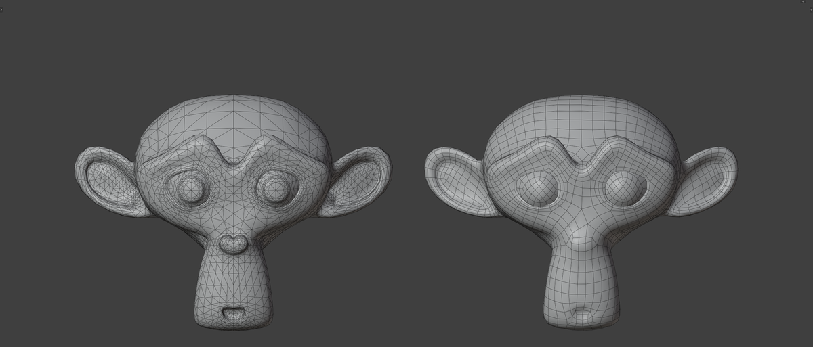
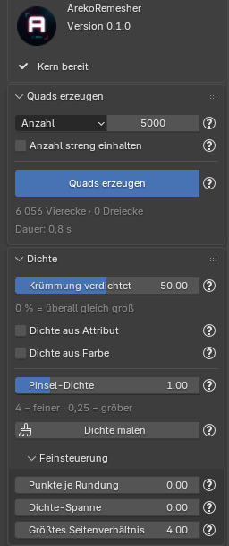
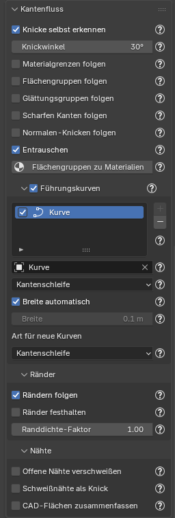
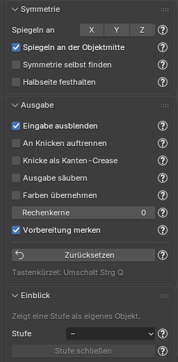
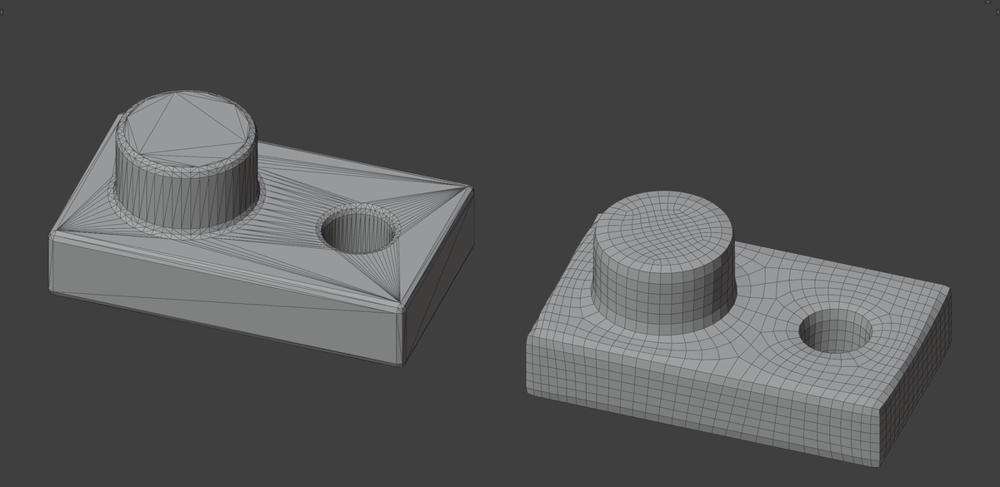
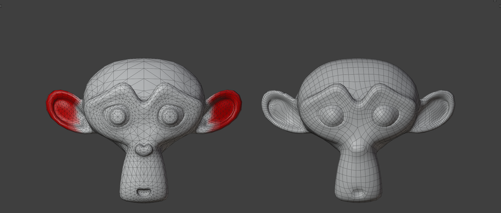
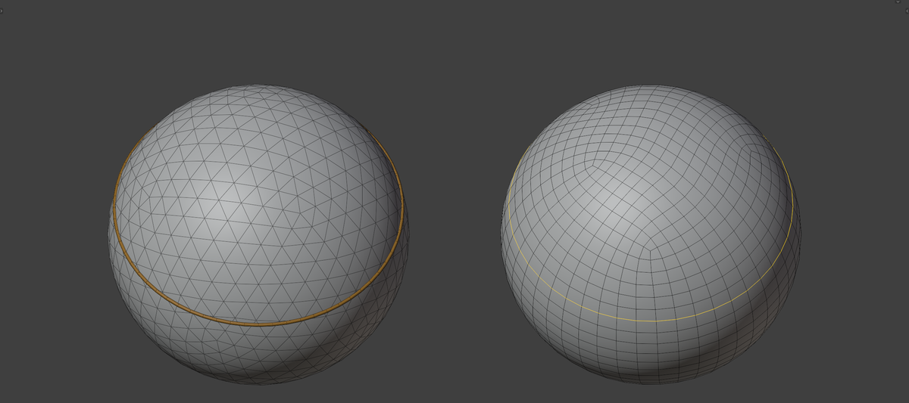

# ArekoRemesher

[English](README.md) · **Deutsch**

ArekoRemesher ist eine Blender-Erweiterung, die aus einem Netz (Dreiecke, Scans, Skulpturen, Boolean- oder CAD-Ergebnisse) ein sauberes Vierecksnetz macht, direkt aus dem Reiter **Areko** der Seitenleiste.



## Voraussetzungen

- **Blender 5.2 oder neuer** (`blender_version_min = "5.2.0"` in `blender_manifest.toml`).
- **Ein Paket je System.** Jede ZIP enthält nur den übersetzten Kern für ihr System und gibt nur dessen Plattformen an:

  | System | Paket | Kernbibliothek |
  |---|---|---|
  | Linux x86-64 | `areko_remesher-0.1.0-linux-x64.zip` | `lib/libarekoremesher.so` |
  | Windows x86-64 | `areko_remesher-0.1.0-windows-x64.zip` | `lib/arekoremesher.dll` |
  | macOS 11.2 oder neuer, Apple Silicon und Intel | `areko_remesher-0.1.0-macos.zip` | `lib/libarekoremesher.dylib` (Universal, arm64 und x86_64) |

- Unter Linux braucht die Kernbibliothek **glibc 2.32 oder neuer** und die **libstdc++ von GCC 13 oder neuer**. Sie wird im Freedesktop-SDK 25.08 gebaut, der Laufzeit des Blender-Flatpaks, und wurde mit dem Blender-5.2-Flatpak getestet.
- Unter Windows ist die C++-Laufzeit in die DLL eingebunden; zusätzliche Laufzeit-DLLs sind nicht nötig.
- Keine zusätzlichen Python-Pakete: Die Erweiterung nutzt nur, was Blender mitbringt (`numpy`, `ctypes`).

> **Windows und macOS:** Diese Pakete werden automatisch gebaut und bestehen dasselbe Prüfprogramm wie der Linux-Bau, wurden aber noch nicht in Blender unter Windows oder macOS ausprobiert. Dort arbeiten andere Compiler und Mathematik-Bibliotheken, deshalb können die Ergebnisse im Detail leicht von Linux abweichen; die Qualität ist dieselbe. Rückmeldungen sind willkommen.

## Paket bauen

`werkzeuge/bauen.sh` baut den Kern im `org.freedesktop.Sdk//25.08` (Flatpak), lässt das Prüfprogramm laufen und packt die Erweiterung mit Blenders eigenem Erweiterungs-Bauwerkzeug (Flatpak `org.blender.Blender`). Das Ergebnis ist `dist/areko_remesher-0.1.0-linux-x64.zip`.

Die Bibliotheken für Windows und macOS baut GitHub Actions (`.github/workflows/kern.yml`) und lässt dort auf beiden Systemen ebenfalls das Prüfprogramm laufen. `werkzeuge/bauen.sh --other-platforms` lädt sie aus dem letzten erfolgreichen Lauf für den aktuellen Commit herunter und packt `dist/areko_remesher-0.1.0-windows-x64.zip` und `dist/areko_remesher-0.1.0-macos.zip`.

```sh
werkzeuge/bauen.sh
werkzeuge/bauen.sh --other-platforms
```

## Installation

1. In Blender **Bearbeiten › Einstellungen… › Get Extensions** öffnen.
2. Oben rechts das kleine Pfeilmenü öffnen und **Install from Disk…** wählen (dieser Punkt ist in Blender nicht übersetzt).
3. Die ZIP für das eigene System auswählen (siehe *Voraussetzungen*), zum Beispiel `areko_remesher-0.1.0-linux-x64.zip`.
4. Im 3D-Ansichtsfenster **N** drücken, um die Seitenleiste zu öffnen, und den Reiter **Areko** anklicken. Oben stehen das runde Areko-Logo, die Version und **Kern bereit**.

## Erster Lauf

1. Im Objektmodus **genau ein Netzobjekt** auswählen. Seine Modifikatoren werden für die Rechnung angewendet; das Netz selbst bleibt unverändert.
2. In **Quads erzeugen** unter *Größe nach* wählen, wie die Größe bestimmt wird (**Anzahl**, **Anteil (%)** oder **Kantenlänge**), und den Wert eintragen. Vorgabe sind etwa 5 000 Vierecke.
3. **Quads erzeugen** anklicken oder im 3D-Ansichtsfenster **Strg Umschalt Q** drücken. Im Panel läuft ein Fortschrittsbalken, Blender bleibt bedienbar; **Esc** oder **Abbrechen (Esc)** beendet den Lauf, und es entsteht nichts.
4. Das Ergebnis ist ein neues Objekt „*Name der Eingabe* Vierecke“. Mit **Eingabe ausblenden** (unter *Ausgabe*, standardmäßig an) wird die Eingabe ausgeblendet. Das Panel zeigt die Zahl der Vierecke und Dreiecke und die Dauer.
5. Für andere Einstellungen die Eingabe wieder auswählen und noch einmal rechnen. Hat *Eingabe ausblenden* sie versteckt, sie im Outliner (Auge) und unter *Objekteigenschaften › Sichtbarkeit* (Ansichtsfenster, Ausführungen) wieder einblenden, oder *Eingabe ausblenden* vor dem Start ausschalten.

Neben jeder Einstellung und jedem Knopf im Reiter steht ein **?**. Mit der Maus darüberfahren: Der Tooltip erklärt, wozu der Punkt gut ist und wann man ihn nutzt, auf Deutsch oder Englisch, je nach Sprache der Blender-Oberfläche.

## Die Panels

### Quads erzeugen, Dichte, Feinsteuerung



| Punkt | Vorgabe | Wozu |
|---|---|---|
| Größe nach (Anzahl / Anteil (%) / Kantenlänge) | Anzahl, 5000 | Wie fein das Ergebnis wird: ungefähr so viele Vierecke, ein Prozentsatz der Flächen der Eingabe oder eine Kantenlänge in Objekteinheiten. |
| Anzahl streng einhalten | aus | An: Die Anzahl wird genau eingehalten. Aus: Sie darf sich etwas der Form anpassen. |
| Quads erzeugen | – | Berechnet das Vierecksnetz aus dem ausgewählten Objekt (Tastenkürzel Strg Umschalt Q). |
| Abbrechen (Esc) | – | Erscheint während der Rechnung; bricht ab, es entsteht nichts. |
| Krümmung verdichtet | 50 | Kleinere Vierecke, wo sich die Fläche stark biegt; 0 = überall gleich groß. |
| Dichte aus Attribut | aus | Das Punktattribut `density` (Kommazahl) bestimmt die Größe: 4 = kleinere Vierecke, 0,25 = größere. |
| Dichte aus Farbe | aus | Das erste Farbattribut bestimmt die Größe: Rot = kleinere Vierecke, Cyan = größere, Weiß = unverändert. |
| Pinsel-Dichte | 1,00 | Farbe des Dichte-Pinsels, von 0,25 (Cyan, größere Vierecke) bis 4 (Rot, kleinere Vierecke). |
| Dichte malen | – | Schaltet das aktive Objekt mit dieser Farbe in die Punktmalerei und schaltet *Dichte aus Farbe* ein. |
| Punkte je Rundung | 0 | Vierecke um eine volle Rundung; 0 = aus *Krümmung verdichtet*. |
| Dichte-Spanne | 0 | Verhältnis größte zu kleinste Vierecke; 0 = aus *Krümmung verdichtet*, 1 = eine Größe. |
| Größtes Seitenverhältnis | 4,00 | Wie lang ein Viereck im Verhältnis zu seiner Breite werden darf. |

### Kantenfluss, Führungskurven, Ränder, Nähte



| Punkt | Vorgabe | Wozu |
|---|---|---|
| Knicke selbst erkennen | an | Findet harte Kanten am Winkel zwischen Flächen und lässt Kantenschleifen ihnen folgen. |
| Knickwinkel | 30° | Flächen, die spitzer als dieser Winkel aufeinandertreffen, bilden einen Knick. |
| Materialgrenzen folgen | aus | Kantenschleifen folgen den Grenzen zwischen Materialien (braucht mindestens zwei Materialien). |
| Flächengruppen folgen | aus | Kantenschleifen folgen den Grenzen zwischen Flächengruppen (Face Sets, im Skulpturmodus gezeichnet). |
| Glättungsgruppen folgen | aus | Kantenschleifen folgen dem Flächenattribut `smoothing_groups`, das Ergebnisse dieser Erweiterung tragen. |
| Scharfen Kanten folgen | aus | Kantenschleifen folgen den als scharf markierten Kanten. |
| Normalen-Knicken folgen | aus | Kantenschleifen folgen den Kanten, an denen die Normalen knicken; schlecht bei flacher Schattierung. |
| Entrauschen | an | Glättet kleines Rauschen der Fläche vor der Rechnung; scharfe Kanten bleiben. |
| Flächengruppen zu Materialien | – | Gibt jeder Flächengruppe des ausgewählten Objekts ein Material in eigener Farbe. |
| Führungskurven (Häkchen im Kopf) | an | Schaltet alle Führungskurven der Liste an oder aus. |
| Liste der Führungskurven mit + und − | leer | Kurvenobjekte, die den Kantenfluss lenken; + fügt die ausgewählten Kurven hinzu, − entfernt die gewählte, das Häkchen schaltet eine Kurve. |
| Kurve | – | Das Kurvenobjekt des gewählten Eintrags. |
| Art | Kantenschleife | *Band*: Vierecke neben der Kurve folgen ihr. *Kantenschleife*: Eine Kantenschleife liegt auf ihr. *Knick*: ebenso, und die Schleife bleibt scharf. *Aus*: übergangen. |
| Breite automatisch | an | Die Breite, in der die Kurve wirkt, ergibt sich aus ihrer Länge. |
| Breite | 0,1 m | Breite der Wirkung, wenn *Breite automatisch* aus ist. |
| Art für neue Kurven | Kantenschleife | Die Art, die hinzugefügte Kurven bekommen. |
| Rändern folgen | an | Kantenschleifen folgen den offenen Rändern (Öffnungen, Säume, Löcher). |
| Ränder festhalten | aus | Die Randpunkte bleiben, wo sie sind; die Größe der Vierecke richtet sich dann nach ihrem Abstand, nicht nach der Anzahl. |
| Randdichte-Faktor | 1,00 | Mit *Ränder festhalten*: über 1 größere, unter 1 kleinere Vierecke als der Randabstand. |
| Offene Nähte verschweißen | aus | Verbindet offene Nähte, deren Randpunkte genau aufeinanderliegen. |
| Schweißnähte als Knick | aus | Verschweißte Nähte zählen als Knick und bleiben scharf. |
| CAD-Flächen zusammenfassen | aus | Fasst schmale Streifen zwischen Flächengruppen zusammen, wie sie CAD-Exporte haben. |

### Symmetrie, Ausgabe, Einblick



| Punkt | Vorgabe | Wozu |
|---|---|---|
| Spiegeln an X / Y / Z | aus | Berechnet eine Hälfte und spiegelt sie an den gewählten Ebenen; Achsen lassen sich kombinieren. |
| Spiegeln an der Objektmitte | an | An: Die Ebene geht durch die Mitte des Objekts. Aus: durch seinen Ursprung. |
| Symmetrie selbst finden | aus | Findet die Spiegelebene jedes Teils selbst, ohne Achsenangabe. |
| Halbseite festhalten | aus | Für ein Netz, das nur eine Hälfte ist: Der Rand an der Spiegelebene bleibt, das Ergebnis bleibt eine Hälfte. Zusammen mit *Ränder festhalten*. |
| Eingabe ausblenden | an | Blendet die Eingabe aus, sobald das Ergebnis da ist. |
| An Knicken auftrennen | aus | Trennt die Punkte des Ergebnisses entlang seiner Knicke. |
| Knicke als Kanten-Crease | aus | Die Knicke des Ergebnisses bekommen vollen Kanten-Crease, für einen Modifikator „Oberflächenunterteilung“. |
| Ausgabe säubern | aus | Löst übrige Kanten auf und trennt Punkte, wo das Ergebnis nicht sauber zusammenhängt. |
| Farben übernehmen | aus | Überträgt das Farbattribut der Eingabe auf das Ergebnis. |
| Rechenkerne | 0 | Kerne für die getrennten Teile eines Netzes; 0 = alle. Das Ergebnis ist bei jeder Anzahl gleich. |
| Vorbereitung merken | an | Überspringt im nächsten Lauf die Vorbereitung, wenn sich nur spätere Einstellungen geändert haben; das Ergebnis ist gleich. |
| Zurücksetzen | – | Setzt alle Einstellungen auf ihre Vorgaben zurück; die Liste der Führungskurven bleibt. |
| Stufe | – | Rechnet bis zur gewählten Stufe und zeigt sie als eigenes Objekt an der Stelle der Eingabe. |
| Stufe schließen | – | Entfernt das Stufenobjekt und zeigt die Eingabe wieder. |

## Tipps

### Technische Teile (Hard-Surface)

**Knicke selbst erkennen** anlassen und den **Knickwinkel** anpassen: senken, damit auch weichere Kanten zählen, erhöhen, wenn Schleifen auf kleinen Knicken landen. Kanten, die du selbst als scharf markierst, folgt **Scharfen Kanten folgen**. Unterteilst du das Ergebnis danach, schalte **Knicke als Kanten-Crease** ein.



### Dichte malen

1. Das Objekt auswählen und die **Pinsel-Dichte** einstellen (zum Beispiel 4 für die feinsten Vierecke).
2. **Dichte malen** anklicken: Das Objekt wechselt in die Punktmalerei, der Pinsel bekommt die Farbe, und *Dichte aus Farbe* wird eingeschaltet. Ein Netz ohne Farben bekommt zuerst ein weißes Farbattribut; sonst wird in sein erstes Farbattribut gemalt.
3. Rot malen, wo du mehr Details willst, Cyan, wo weniger Vierecke reichen. Dann zurück in den Objektmodus und **Quads erzeugen** anklicken.



### Führungskurven

1. Ein Kurvenobjekt hinzufügen und auf oder dicht über die Fläche legen, zum Beispiel um einen Hals oder entlang einer Fuge.
2. Die Kurve auswählen und in der Liste *Führungskurven* auf **+** klicken. Unter **Art** *Kantenschleife* für eine genaue Schleife wählen, *Band* für eine grobe Richtung oder *Knick* für eine scharfe Schleife.
3. Das Netz wieder auswählen und **Quads erzeugen** anklicken.



### Symmetrie

- Bei einem Modell, das nach vorn schaut, unter *Spiegeln an* **X** einschalten: Eine Hälfte wird gerechnet und gespiegelt, das Ergebnis ist genau symmetrisch.
- Ist das Objekt um seinen Ursprung symmetrisch, sein Umriss aber nicht (zum Beispiel eine Figur, die etwas in einer Hand hält), **Spiegeln an der Objektmitte** ausschalten.
- Für Teile, die symmetrisch, aber nicht an den Achsen ausgerichtet sind, **Symmetrie selbst finden** nutzen.
- Für ein Netz, das nur eine Hälfte ist (für einen Modifikator „Spiegeln“), **Halbseite festhalten** zusammen mit **Ränder festhalten** und der Achse der Spiegelebene nutzen.

### Hineinschauen

Unter **Einblick** zeigt **Stufe** eine Stufe der Rechnung als eigenes Objekt, zum Beispiel *Merkmalslinien* (welche Knicke gefunden wurden) oder *Größenfeld* (wo die Vierecke klein werden). Solange eine Stufe gezeigt wird, frischen geänderte Einstellungen sie nach einem Moment auf. **Stufe schließen** holt die Eingabe zurück.

## Lizenz

ArekoRemesher steht unter der **GNU General Public License v3.0 oder neuer** (siehe [LICENSE](LICENSE)), wie Blender es für Erweiterungen verlangt, die seine Python-Schnittstelle nutzen.

Der Kern enthält fremden Code unter dessen eigenen Lizenzen: [Eigen](https://eigen.tuxfamily.org) und [CDT](https://github.com/artem-ogre/CDT) (beide MPL 2.0) sowie den Polygon-Tessellator von [GLU](https://archive.mesa3d.org/glu/) (SGI Free Software License B 2.0). Die Lizenzdateien liegen in `fremd/`, und jedes Paket enthält sie in `THIRD-PARTY-NOTICES.txt`.
