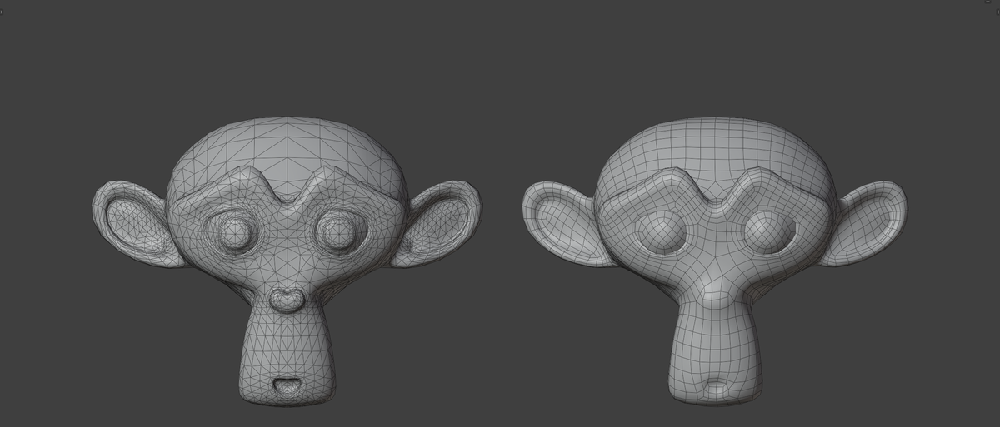
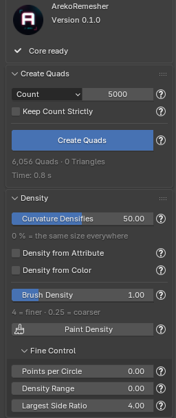
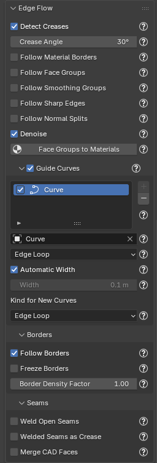
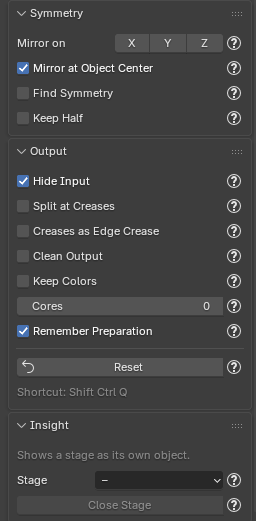
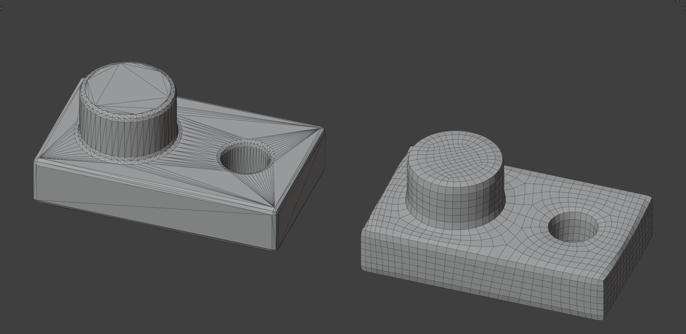
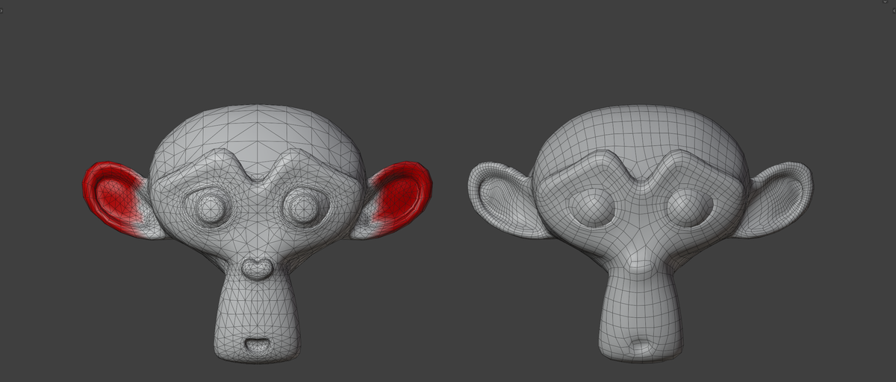
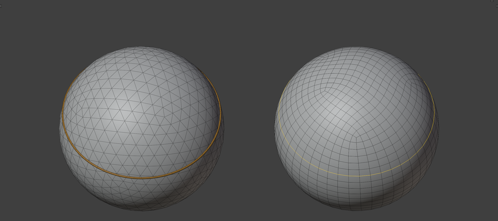

# ArekoRemesher

**English** · [Deutsch](README.de.md)

ArekoRemesher is a Blender extension that turns a mesh (triangles, scans, sculpts, boolean or CAD results) into a clean quad mesh, right from the sidebar tab **Areko**.



## Requirements

- **Blender 5.2 or newer** (`blender_version_min = "5.2.0"` in `blender_manifest.toml`).
- **Linux, x86-64 only.** The package contains the compiled core `lib/libarekoremesher.so` and declares the platform `linux-x64`; there is no build for Windows or macOS.
- The core library needs **glibc 2.32 or newer** and **libstdc++ of GCC 13 or newer**. It is built in the Freedesktop SDK 25.08, the runtime of the Blender Flatpak, and it was tested with the Blender 5.2 Flatpak.
- No extra Python packages: the extension uses only what Blender brings (`numpy`, `ctypes`).

## Building the package

`werkzeuge/bauen.sh` builds the core inside `org.freedesktop.Sdk//25.08` (Flatpak), runs the check program and packs the extension with Blender's own extension builder (Flatpak `org.blender.Blender`). The result is `dist/areko_remesher-0.1.0.zip`.

```sh
werkzeuge/bauen.sh
```

## Installation

1. In Blender open **Edit › Preferences… › Get Extensions**.
2. Open the small arrow menu at the top right and choose **Install from Disk…**.
3. Pick `areko_remesher-0.1.0.zip`.
4. In the 3D Viewport press **N** to open the sidebar and click the tab **Areko**. At the top you see the round Areko logo, the version and **Core ready**.

## First run

1. In Object Mode select **exactly one mesh object**. Its modifiers are applied for the computation; the mesh itself is not changed.
2. In **Create Quads** choose under *Size by* how the size is set (**Count**, **Share (%)** or **Edge Length**) and enter the value. The default is about 5,000 quads.
3. Click **Create Quads** or press **Ctrl Shift Q** in the 3D Viewport. A progress bar runs in the panel and Blender stays usable; **Esc** or **Cancel (Esc)** stops the run and creates nothing.
4. The result is a new object named "*input name* Quads". With **Hide Input** (in *Output*, on by default) the input is hidden. The panel shows the number of quads and triangles and the time.
5. To try other settings, select the input again and run once more. When *Hide Input* has hidden it, show it again in the Outliner (eye) and under *Object Properties › Visibility* (Viewports, Renders), or turn *Hide Input* off before you start.

Every setting and button in the tab has a **?** beside it. Hover over it with the mouse: the tooltip explains what the point is for and when to use it, in English or German, following Blender's interface language.

## The panels

### Create Quads, Density, Fine Control



| Point | Default | What it is for |
|---|---|---|
| Size by (Count / Share (%) / Edge Length) | Count, 5000 | How fine the result gets: about this many quads, a percentage of the input's faces, or an edge length in object units. |
| Keep Count Strictly | off | On: the count is kept exactly. Off: it may change a little to suit the shape. |
| Create Quads | – | Computes the quad mesh from the selected object (shortcut Ctrl Shift Q). |
| Cancel (Esc) | – | Shown while computing; stops the run, nothing is created. |
| Curvature Densifies | 50 | Smaller quads where the surface bends strongly; 0 = the same size everywhere. |
| Density from Attribute | off | The float point attribute `density` sets the size: 4 = smaller quads, 0.25 = larger. |
| Density from Color | off | The first colour attribute sets the size: red = smaller quads, cyan = larger, white = unchanged. |
| Brush Density | 1.00 | Colour of the density brush, from 0.25 (cyan, larger quads) to 4 (red, smaller quads). |
| Paint Density | – | Switches the active object to Vertex Paint with that colour and turns on *Density from Color*. |
| Points per Circle | 0 | Quads around a full round bend; 0 = taken from *Curvature Densifies*. |
| Density Range | 0 | Largest to smallest quad size; 0 = taken from *Curvature Densifies*, 1 = one size. |
| Largest Side Ratio | 4.00 | How long a quad may get compared to its width. |

### Edge Flow, Guide Curves, Borders, Seams



| Point | Default | What it is for |
|---|---|---|
| Detect Creases | on | Finds hard edges by the angle between faces and lets edge loops follow them. |
| Crease Angle | 30° | Faces meeting at a sharper angle than this form a crease. |
| Follow Material Borders | off | Edge loops follow the borders between materials (needs at least two materials). |
| Follow Face Groups | off | Edge loops follow the borders between face sets (drawn in Sculpt Mode). |
| Follow Smoothing Groups | off | Edge loops follow the face attribute `smoothing_groups`, which results of this extension carry. |
| Follow Sharp Edges | off | Edge loops follow the edges marked sharp. |
| Follow Normal Splits | off | Edge loops follow the edges where the normals split; poor on flat shaded models. |
| Denoise | on | Smooths small noise of the surface before computing; sharp edges stay. |
| Face Groups to Materials | – | Gives every face set of the selected object a material in its own colour. |
| Guide Curves (checkbox in the header) | on | Switches all guide curves of the list on or off. |
| Guide curve list with + and − | empty | Curve objects that steer the edge flow; + adds the selected curves, − removes the chosen one, the checkbox switches one curve. |
| Curve | – | The curve object of the chosen entry. |
| Kind | Edge Loop | *Band*: quads beside the curve follow it. *Edge Loop*: an edge loop lies along it. *Crease*: the same, and the loop stays sharp. *Off*: ignored. |
| Automatic Width | on | The width of the curve's influence follows from its length. |
| Width | 0.1 m | Width of the influence when *Automatic Width* is off. |
| Kind for New Curves | Edge Loop | The kind that curves get when they are added. |
| Follow Borders | on | Edge loops follow the open borders (openings, hems, holes). |
| Freeze Borders | off | The border points stay where they are; the quad size then follows their spacing, not the count. |
| Border Density Factor | 1.00 | With *Freeze Borders*: above 1 larger quads, below 1 smaller ones than the border spacing. |
| Weld Open Seams | off | Joins open seams whose border points lie exactly on top of each other. |
| Welded Seams as Crease | off | Welded seams count as creases and stay sharp. |
| Merge CAD Faces | off | Merges narrow strips between face groups, as CAD exports have them. |

### Symmetry, Output, Insight



| Point | Default | What it is for |
|---|---|---|
| Mirror on X / Y / Z | off | Computes one half and mirrors it across the chosen planes; axes can be combined. |
| Mirror at Object Center | on | On: the plane runs through the middle of the object. Off: through its origin. |
| Find Symmetry | off | Finds the mirror plane of every part by itself, without an axis. |
| Keep Half | off | For a mesh that is only one half: the border on the mirror plane stays, the result stays a half. Use with *Freeze Borders*. |
| Hide Input | on | Hides the input once the result is there. |
| Split at Creases | off | Splits the points of the result along its creases. |
| Creases as Edge Crease | off | The creases of the result get full edge crease, for a Subdivision Surface modifier. |
| Clean Output | off | Dissolves stray edges and separates points where the result is not manifold. |
| Keep Colors | off | Carries the colour attribute of the input over to the result. |
| Cores | 0 | Cores for the separate pieces of a mesh; 0 = all. The result is the same for every number. |
| Remember Preparation | on | Skips the preparation in the next run when only later settings changed; the result is the same. |
| Reset | – | Sets all settings back to their defaults; the guide curve list stays. |
| Stage | – | Computes up to the chosen stage and shows it as an object of its own in place of the input. |
| Close Stage | – | Removes the stage object and shows the input again. |

## Tips

### Hard-surface parts

Leave **Detect Creases** on and adjust **Crease Angle**: lower it so that softer edges count too, raise it when loops land on small kinks. Edges you mark sharp yourself are followed with **Follow Sharp Edges**. If you subdivide the result afterwards, turn on **Creases as Edge Crease**.



### Painting the density

1. Select the object and set **Brush Density** (for example 4 for the finest quads).
2. Click **Paint Density**: the object switches to Vertex Paint, the brush gets the colour and *Density from Color* is turned on. A mesh without colours first gets a white colour attribute; otherwise its first colour attribute is painted on.
3. Paint red where you want more detail, cyan where fewer quads will do. Then go back to Object Mode and click **Create Quads**.



### Guide curves

1. Add a curve object and place it on or close to the surface, for example around a neck or along a panel line.
2. Select the curve and click **+** in the *Guide Curves* list. Under **Kind** choose *Edge Loop* for an exact loop, *Band* for a general direction or *Crease* for a sharp loop.
3. Select the mesh again and click **Create Quads**.



### Symmetry

- For a model facing forward, turn on **X** under *Mirror on*: one half is computed and mirrored, the result is exactly symmetric.
- If the object is symmetric about its origin but its outline is not (for example a figure holding something in one hand), turn off **Mirror at Object Center**.
- For parts that are symmetric but not aligned with the axes, use **Find Symmetry**.
- For a mesh that is only one half (for a Mirror modifier) use **Keep Half** together with **Freeze Borders** and the axis of the mirror plane.

### Looking inside

Under **Insight**, **Stage** shows one stage of the computation as an object of its own, for example *Feature Lines* (which creases were found) or *Size Field* (where the quads get small). While a stage is shown, changed settings update it after a moment. **Close Stage** brings the input back.
